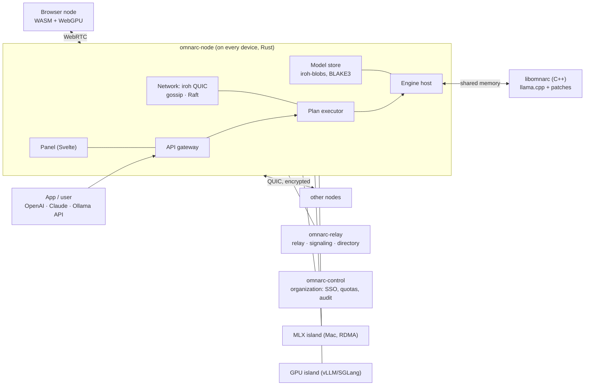

# Omnarc — the full plan (v3.2, October 13, 2026)

> **What gets built** — [REQUIREMENTS.md](REQUIREMENTS.md). **How it gets built** — this file: architecture,
> technologies, protocols, design system, screens and stages. **Every screen and function with its state** —
> [SPEC.md](SPEC.md).
> Design concept (screens): [design/concept.html](design/concept.html). The living ring: [design/living-ring.js](design/living-ring.js),
> video: [design/living-ring.mp4](design/living-ring.mp4).
> Design tokens: [design/tokens.json](design/tokens.json) (W3C DTCG), [design/tokens.css](design/tokens.css);
> source and contrast report: [design/colors.py](design/colors.py).

## 0. In short

Omnarc unites any devices — computers, phones, servers, browsers — into one AI cluster.
Every device you add grows four things: the size of model that fits, the number of people served at once, the speed
of a single answer and its accuracy. It works from one home to the whole world; it answers, and it trains models too.
Three uses come first ([REQUIREMENTS §1](REQUIREMENTS.md)): agents on your own frontier-class model, the family ring
and accuracy mode.

## 1. Architecture



| Component | Language | Job | Built from |
|---|---|---|---|
| `omnarc-node` | Rust | the agent on every device: network, plan execution, API, panel, model store | ideas from exo `rust/networking`, `master/placement.py` |
| `libomnarc` | C++20 | computing a slice of layers, piped-ring, speculative decoding, KV | llama.cpp, prima.cpp, PowerInfer |
| `omnarc-web` | TypeScript, Svelte 5 | panel, browser node (PWA), design system | exo `dashboard` |
| `omnarc-desktop` | Rust + Tauri 2 | Linux/Windows/macOS app, tray | — |
| `omnarc-android` | Kotlin, Compose | phone app, foreground service, widget | prima's Android experience |
| `omnarc-ios` | Swift, SwiftUI | iPhone/iPad app, Live Activity | — |
| `omnarc-control` | Python, FastAPI | organization control: users, SSO, quotas, metering | GPUStack server |
| `islands/mlx` | Python | Mac groups, RDMA over Thunderbolt 5 | exo `worker/engines/mlx` |
| `islands/gpu` | Python | NVIDIA/AMD servers: vLLM, SGLang | GPUStack `worker/backends` |
| `omnarc-relay` | Rust | relay, WebRTC signaling, public network directory | iroh-relay |
| `omnarc-bench` | Rust + Python | W1–W13 measurements, comparison with competitors | — |

Vendored code keeps an `UPSTREAM.md`: the upstream URL, the commit, and the list of our changes.

## 2. Technologies — the strongest choice at every layer

| Layer | Choice | Why | Rejected |
|---|---|---|---|
| Engine | **llama.cpp / ggml** (unmodified submodule) + a small patch set, C++20 | one engine, 10 backends: CUDA, HIP, Vulkan, Metal, OpenCL, Hexagon NPU, SYCL, CANN, WebGPU, CPU | prima's old fork (frozen, old models); MLC/TVM (per-model compilation); PyTorch (not on phones) |
| Node agent | **Rust** (tokio, axum) | one codebase for 5 platforms, memory safety, a binary small enough for phones | Python (exo — not on phones); Go (heavy mobile FFI) |
| P2P network | **iroh 1.x**: QUIC, dial devices by key instead of IP, NAT hole punching (~90% direct), our own relay; iroh-gossip, iroh-blobs | stable since 1.0 in June 2026, official Rust/Swift/Kotlin bindings | libp2p (more complex); ZeroMQ (prima — no hole punching, no encryption) |
| Browser transport | **WebRTC DataChannel** (Rust: str0m) | iroh in the browser only works through a relay; WebRTC connects directly on the LAN | WebSocket (TCP, high latency) |
| Consensus | **openraft** — 3–5 stable nodes (computers/servers) | firm agreement on plan versions and keys; phones never vote | a single leader (exo — the cluster stops when it drops) |
| Protocol | **Protobuf + buf**; control API — **Connect RPC** | one `.proto` generates TS, Kotlin, Swift and Python clients | REST + hand-written clients |
| Tensor stream | our own binary frame format, zero-copy | no extra work per token | gRPC (heavy for tensors) |
| Scheduling | **HiGHS** MILP (prima's Halda formulation, extended) + Parallax's two-phase routing + **EPLB** (MoE) | the strongest open optimizer (MIT) | hand-written heuristics |
| Model distribution | **iroh-blobs**: BLAKE3-verified streaming by byte range | every device fetches only its own tensors, resumes after a drop, rejects corrupted chunks | HTTP downloads (each device separately from the internet) |
| Storage | **redb** (node), **PostgreSQL 17** (control), **Prometheus** | redb is pure Rust, ACID, runs on phones | SQLite (C dependency, harder mobile builds) |
| Authorization | **Ed25519** identity + **Biscuit** tokens + OIDC/LDAP (organizations) | rights can be narrowed and delegated without a central server (model, quota, expiry) | plain API keys |
| Public verification | **TOPLOC** (MIT) + random recomputation; credits in a **transparency log** (C2SP tlog-tiles) | ~100× cheaper than recomputation; anyone can audit the log | blockchain (slow, expensive) |
| Panel and web | **SvelteKit 2 + Svelte 5**, strict TypeScript, **Tailwind CSS 4**, **Bits UI**, **Paraglide JS**, **Connect-ES** | exo's dashboard is exactly Svelte 5 + Tailwind 4 + d3 — its components carry over; the smallest bundles (browser node page ≤ 60 KB) | React + Ant Design (GPUStack UI — heavy bundle, generic SaaS look) |
| Graphics | the Ring — **SVG + Canvas**; the living ring — **WebGL2**; globe — **MapLibre GL 5** + **deck.gl 9** + **Protomaps PMTiles** (offline maps); charts — **uPlot** + d3-scale | 60 fps with 1,000 devices; maps work without outside services | Google/Mapbox maps (external dependency) |
| Motion | CSS + Svelte transitions + **GSAP 3** + the **View Transitions API** | GSAP is fully free since 2025; page transitions come from the browser itself | heavy animation libraries |
| Desktop | **Tauri 2** (Rust host + system WebView) | ~10 MB app, memory stays free for the model; the agent runs in-process | Electron (150+ MB, eats memory) |
| Android | **Kotlin + Jetpack Compose** (Material 3 Expressive), Rust core through **UniFFI**, Glance widget | foreground service, NPU, widgets, Quick Settings — all native | Flutter, React Native (these parts would be native anyway) |
| iOS | **Swift 6 + SwiftUI** (Liquid Glass), UniFFI XCFramework, ActivityKit, WidgetKit, App Intents | Live Activity, Dynamic Island, Siri — native only | cross-platform shells |
| Browser node | **llama.cpp → WASM** (Emscripten) + **ggml-webgpu**, PWA | the same GGUF format everywhere; the WebGPU backend got 45–69% faster in 2026 | web-llm (MLC — a second format) |
| Docs | **Astro Starlight** + Pagefind | multilingual, offline search | — |
| Quality | nextest, proptest, **turmoil** (deterministic network simulation), **TLA+**, cargo-fuzz/libFuzzer, ASan/UBSan, Vitest, **Playwright** (visual regression), axe-core, Lighthouse CI, **Maestro** (mobile), Storybook | distributed-system bugs are only caught this way | manual testing |
| Build and CI | Cargo + CMake presets + pnpm + Gradle + Xcode, `just`; a GitHub Actions matrix; sccache | Linux x64/arm64, Windows, macOS, Android (API 26/30/34/36), iOS, 3 browsers | — |
| Releases | cosign signatures, SBOM (CycloneDX), SLSA provenance, signed Tauri updates | supply-chain protection for an open project | unsigned binaries |
| Observability | **OpenTelemetry** (tracing) + Prometheus | the token-path timeline is built from these traces | — |

Telemetry: by default **nothing** is sent anywhere.

## 3. Protocols

1. **Identity.** Every device holds an Ed25519 key (iroh NodeId). A cluster has its own key; membership is granted
   with a Biscuit token. Rights: `node` (hold layers), `user` (API), `admin`.
2. **Pairing.** The QR code carries a cluster ticket (iroh ticket) and a 10-minute one-time secret. Both screens show
   four emoji (SAS); if they match, the pairing is confirmed. No stranger's device can join unnoticed.
3. **Transport.** native↔native — QUIC (iroh). browser↔native — WebRTC DataChannel, with signaling over the relay.
   Stream priority: tensors > control > telemetry > model files.
4. **Tensor frame.** A 32-byte header (request ID, step, position range, dtype f16/bf16/f8e4m3/i8, scale, length)
   + payload. It travels on a unidirectional QUIC stream and lands in a ggml buffer without copying.
5. **Control messages.** Protobuf, version `omnarc.v1`. New fields are always optional, so old nodes keep working
   with new ones.
6. **State.** Telemetry once per second over iroh-gossip (HyParView/PlumTree). Raft holds the plan version, model
   placement and keys.
7. **Discovery.** mDNS on the LAN; iroh DNS/pkarr on the internet; mainline DHT + a directory on the public network.
8. **Models.** One node downloads from Hugging Face → BLAKE3 hash → iroh-blobs. GGUF tensor offsets become byte
   ranges. Each node fetches only its own layers and resumes where it stopped if the connection drops.

## 4. Engine — libomnarc

- **llama.cpp submodule + `patches/`** (layer window [a, b), hidden-state input/output, external KV management).
  Every week CI rebases the patches onto the newest upstream automatically and runs the tests. The patches are sent
  upstream as pull requests — the goal is to need no patches at all. This way we never freeze on an old version the
  way prima.cpp did.
- **From prima.cpp:** piped-ring and disk prefetching (`src/llama.cpp`), the device profiler
  (`common/profiler.cpp`), Halda/HiGHS (`common/common.cpp`), speculative decoding (`common/speculative.cpp`).
- **Continuous pipeline + speculative decoding** (the PipeSpec, FlowSpec and DiP-SD algorithms). Draft sources:
  MTP heads (DeepSeek V3, Qwen3-Next), EAGLE-3, a small model, n-grams.
- **PowerInfer:** the hot/cold neuron predictor and sparse FFN kernels.
- **KV:** paged cache, radix prefix cache, q8/q4 KV, continuous copies to a neighbor (Y7), ring attention (Y9).
- **Activation compression:** f8e4m3 with a per-token scale. The error bound is measured by the accuracy gate.
- **A separate process.** On computers and servers the engine runs in its own process and talks to the agent through
  shared memory. If the engine crashes, the agent keeps running and the layers move to replicas. On phones the engine
  runs in-process, because iOS does not allow child processes.
- **Accuracy gate.** For every backend and quantization the output is compared with a single-device run:
  logit KL ≤ 0.01, perplexity difference ≤ 0.5%. NPU operations pass the same gate (Y3).

## 5. Scheduler

- **Profiler** (~20 s when a device joins): FLOPS per backend × quantization, memory bandwidth, disk reads, NPU
  operations.
- **Budgets (Q1, Q7).** Every device announces what it offers -- memory, cores or GPU share, and the hours it
  is willing -- and that is a hard constraint of the placement, never a suggestion. This holds at both ends:
  a 2 GB phone offering 500 MB is planned for exactly as carefully as a 64 GB workstation that offers 8 GB
  while its owner works, or an office machine that offers everything after 19:00 and nothing before. The plan
  may use less than offered and never more. Nothing is placed by device count: two devices offering 500 MB
  each are not one device offering 1 GB, and the profiler is what tells them apart.
- **Placement.** HiGHS MILP runs on the coordinator: ≤ 1 s for ≤ 64 nodes. Larger networks are split into groups of
  64 and planned hierarchically.
- **Never slower (R6).** A model that fits on one device is not split over a slower link: in a public test, splitting
  such a model over Wi-Fi made it 3–5× slower (Mesh LLM: 68 → 21 → 12–13 tokens/s on 1 → 2 → 3 Macs). Extra devices
  get whole copies instead — more people at once, accuracy mode, prefill on a GPU or NPU device. Layers are split only
  when a model does not fit.
- **Routing.** For every request, Parallax's DP picks the fastest path through the replica graph.
- **Events.** When a device joins, leaves, overheats or runs low on battery, a precomputed backup plan takes over
  within ≤ 1 s; the full re-plan is computed in the background.
- **Objective** by mode: latency (TPOT), throughput (tokens/s), efficiency (J/token), accuracy (Y10).
- **MoE.** Experts are placed by co-activation statistics; hot experts are replicated with EPLB.

## 6. Device apps

1. **Desktop (Linux, Windows, macOS)** — Tauri 2.
   - The tray icon is a small ring; its fill shows the device's load.
   - The owner sets the resource share (RAM %, GPU %, CPU cores) and a schedule; an "only while idle" mode exists.
   - Auto-updates are signed.
   - Installers: MSI, DMG (notarized), AppImage/deb/rpm, Flatpak, Homebrew, winget, Nix.
2. **Server** — the `omnarc-node` CLI + systemd, a Docker image, a Helm chart (from GPUStack).
3. **Android.** minSdk 26 (Android 8); GPU features are checked at runtime. CI tests on API 26/30/34/36 emulators.
   - **Foreground service:** `specialUse` on API ≥ 34 — no time limit. From Android 15, `dataSync` is limited to
     6 hours per day, so it cannot run all night. `dataSync` on API < 34.
   - Quick Settings tile, Glance widget, live status inside the notification.
4. **iOS** (iOS 17+). iOS does not allow long background compute. That is why there is **Night mode**: the phone
   charges, the app stays open, and the almost-black OLED screen shows the time and the ring.
   - A Live Activity shows the status on the Lock Screen and in the Dynamic Island.
   - Widget and Siri/Shortcuts ("Share my power").
5. **Browser.** A PWA.
   - WebGPU only works on secure pages (HTTPS), so the page loads from the project's HTTPS address, stays cached and
     connects to LAN nodes over WebRTC.
   - On a network with no internet at all, a browser node only works if the page was cached before; otherwise the
     native app is installed.
   - Supported: Chrome/Edge 113+, Android Chrome 121+, Safari 26+, Firefox 141+ (Windows).

## 7. Security and privacy

- All traffic is encrypted: QUIC TLS 1.3, DTLS in the browser.
- API keys are Biscuit tokens: they can be restricted by model, quota and expiry.
- Public network ([REQUIREMENTS §4](REQUIREMENTS.md)):
  - raw text never leaves the owner's device;
  - TOPLOC proofs plus 1–2% random recomputation;
  - credit receipts signed with Ed25519 are written to a transparency log.
- Model integrity is checked with BLAKE3. Builds are reproducible; releases ship with cosign signatures and an SBOM.

## 8. Quality gates (every PR and the end of every stage)

1. All tests are green. A silent "skipped" counts as a failure.
2. Accuracy gate (logit KL, perplexity).
3. Deterministic simulation (turmoil): 1,000 random drop/join scenarios — not a single answer is lost.
4. A TLA+ model: the re-planning and KV-copy protocol passes safety and liveness properties in TLC.
5. Fuzzing: the frame parser, protobuf and the GGUF reader run 24 hours without a crash.
6. UI: visual regression (2 themes × 390/768/1440 px), axe — 0 violations, the whole app works from the keyboard,
   bundle budgets hold, font sizes come only from the scale (enforced by a linter).
7. Benchmarks: every stage measures its W criteria and records them in a report.

## 9. UI/UX

### 9.1 Principles

1. **Show the mechanism.** The screen shows the real process: which device computes which layers, where a token is
   right now, where it slows down.
2. **Health at a glance.** The state of the cluster is understood in one second.
3. **Join in 30 seconds.**
4. **The owner stays in control.** The owner decides what a device gives and when; the limits are always visible.
5. **Quiet by default.** Contributing in the background never gets in the way.
6. **For everyone.** English first, with Chinese, Spanish, Hindi, Arabic (right to left), French, Portuguese and
   Russian translations; WCAG 2.2 AA; reduced-motion mode; safe for color-vision deficiency.
7. **Fast.** 60 fps and strict budgets (9.8).

### 9.2 Visual language — the Ring

prima's piped-ring method is literally a ring: the devices sit around it and a token travels through them. So the
logo and the home screen are a ring too. Arcs of different lengths (different devices) together form one circle —
that is the Omnarc idea itself.

- **Logo:** five uneven arcs and one dot (the token).
- **Colors** (OKLCH, mineral pigments — lapis, turquoise and gold on a warm plaster white):

  | Token | Dark (default) | Light | Role |
  |---|---|---|---|
  | `--bg` | `#060a13` | `#fbf9f6` (plaster) | page background |
  | `--surface-1/2/3` | `#0d131d` / `#151c28` / `#1e2533` | `#ffffff` / `#f4f2ee` / `#ece9e4` | cards, panels |
  | `--text-1/2/3` | `#f1f3f8` / `#bcc3cf` / `#949ca9` | `#0f1726` / `#3f4858` / `#5d6574` | text (the faintest: 5.25:1) |
  | `--turquoise` | `#3dd7cf` | `#007573` | the single accent: primary button, focus, tokens |
  | `--gold` | `#f2c156` | `#966000` | credits (text) |
  | `--gold-mark` | `#f2c156` | `#c17b00` | tokens, the logo dot (graphics, ≥ 3:1) |
  | `--lapis` | `#6189f0` | `#2243ae` | selection, links |

  Every text pair passes AA in both themes (≥ 4.5:1, measured by `design/colors.py`).
  There is one accent (turquoise); the rest of the interface stays neutral and color appears only where it means
  something.
- **Chart colors:** compute (aqua), network (blue), draft (orange) — three colors. They pass color-vision-deficiency
  checks for every pair in both themes (CVD ΔE ≥ 9.2). Load uses a 7-step turquoise scale. Status uses four colors,
  always with an icon and a label.
- **Fonts:** **Inter** (variable, optical sizes) + **IBM Plex Mono** (numbers, IDs) for Latin, Cyrillic and Greek;
  **Noto Sans SC**, **Noto Sans Arabic** and **Noto Sans Devanagari** for Chinese, Arabic and Hindi. A script's font
  loads only when its language is on (`unicode-range`). Fonts are served by us (woff2) — no outside requests.
- **Type scale** (9 steps): 11 · 12 · 13 · 14 · 16 · 20 · 28 · 40 · 56. Any other size is forbidden.
- **Layout:** a 4px spacing grid (4…64), radii 6/10/16, 1px hairlines.
- **Motion:** durations 120/200/320/480 ms, easing `cubic-bezier(.2,.8,.2,1)`.
  - Only `transform` and `opacity` are animated.
  - Entrance animations use `fill-mode: backwards`.
  - In reduced-motion mode particles turn off and flows are shown with arrows.

### 9.3 The living ring

The mark is not a drawing — it is a live model of how the system works.
Code: [design/living-ring.js](design/living-ring.js) — WebGL2, no dependencies, ~16 KB.
Where it appears: the public site, the app's launch screen, first run, and the moment a device joins.

- **Arcs and particles.** Every arc is one device; its length is its share of layers. An arc is made of ~15,000
  particles: a bright inner filament, the main core, dust and a soft glow. The GPU computes their motion; the CPU is
  not involved.
- **Tokens.** Gold comets; as many tokens are in flight as there are devices (continuous pipelining).
  - The spot a token passes lights up and warms toward gold.
  - Faint sparks ahead of a comet are draft tokens; rejected ones fade.
  - The top gap is the output: every finished token sends out a wave.
- **Intro scene "Unity" (2.6 s).** Scattered points spiral in and the arcs form one after another. Device names
  appear only once the ring is complete.
- **Interaction.**
  - The pointer or a finger tilts the ring in 3D.
  - Hovering an arc lights it up and shows the device name.
  - "Add a device" grows a new arc, redistributes the 64 layers (largest remainder method) and adds one more token.
- **Reduced-motion mode:** the formed ring is drawn statically.
- **Without WebGL2:** the SVG mark appears.
- **Efficiency:** drawing stops when the mark leaves the screen.

### 9.4 The Ring view (home screen)

- **Arcs.** Every device is one arc. The arc length equals the share of layers on that device. Arcs are separated by
  a 2px gap (no outline is drawn). The arc color shows the current load (turquoise scale).
- **Token flow.** A token is a dot moving around the ring. Its speed on each arc equals the real measured time, so a
  slow device stands out immediately. Draft tokens travel as several faint dots at once: accepted ones brighten,
  rejected ones fade. This is how Y1 becomes visible.
- **Center.** One hero number — tokens/s. Below it, the model name and the mode.
- **Thin outer markers:** charging, temperature and battery — always with an icon.
- **Several models** running at once are drawn as nested rings. Past 128 devices, arcs merge into groups that expand
  on click.
- **Accessibility.** A "Table" button shows the same data as a table. Keyboard focus moves from arc to arc. A screen
  reader hears a short summary ("6 devices; the slowest is the phone at 38 ms").

### 9.5 Panel structure

| Section | Shows | Main action |
|---|---|---|
| Ring | the live cluster, the hero number, the device list | choose a model, a mode |
| Devices | each device: backend, memory, temperature, share, links | share and schedule, remove |
| Models | catalog, "Will it fit?", P2P download | launch |
| Chat | a playground showing which device computed each token and, in accuracy mode, how many devices agreed | ask |
| Observe | the token-path timeline, the link matrix, traces | find the slow spot |
| Training | LoRA and RL jobs, rounds, loss | start a job |
| Network | the public network globe, credits | join, leave |
| Organization | users, keys, quotas, schedules, audit | policy |
| Settings | language, theme, security, updates | — |

Any action can also be run from the **⌘K command palette**; every action has a keyboard shortcut. The panel gets
live data over a Connect stream.

### 9.6 Key flows

1. **First run (≤ 60 s).**
   - The device is detected and goes through a 20-second benchmark.
   - The owner creates a cluster or joins an existing one (clusters on the LAN show up by themselves).
   - The share is set.
   - A new arc grows on the ring.
2. **Adding a device (≤ 30 s).** A QR code on the computer → the phone camera → confirming four emoji. The new device
   takes its place on the ring and the other arcs rebalance smoothly.
3. **Launching a model.**
   - "Will it fit?": the memory needed is compared with the cluster's memory, and an expected speed range is shown.
   - The placement plan appears on the ring in advance.
   - The model downloads peer-to-peer and starts.
4. **Phone contribution.** One big button: "Share my power". Rules: only while charging, only on Wi-Fi,
   battery ≥ 40%, temperature ≤ 40 °C, RAM ≤ 50%, a schedule.
5. **A device drops.**
   - When a device leaves, its arc fades and the replica lights up.
   - A notification appears: "Phone disconnected — a replica took over (0.8 s)".
6. **A weak phone as a voice client (Q6).** The phone scans the ring's QR code and joins as a client; one button —
   hold to speak — and the answer is spoken back.

### 9.7 Platform experience

- **Desktop:** the ring in the tray.
- **iOS:** Live Activity, Dynamic Island, widget, Siri, Night mode.
- **Android:** Quick Settings tile, Glance widget, live status in the notification.
- **iOS 26:** adopts Liquid Glass.
- **Android:** adopts Material 3 Expressive.
- **The shared brand** (color tokens, fonts, the ring) is the same on all three platforms. Tokens are built from one
  JSON file into CSS, Swift and Kotlin.

### 9.8 Budgets

- Initial panel JS ≤ 180 KB (gzip).
- Browser-node page ≤ 60 KB (the model slice is not counted).
- The Ring at 60 fps with 1,000 devices.
- LCP ≤ 1.5 s (LAN).
- Mobile cold start ≤ 1 s.

### 9.9 Language

English is the source language. Translations — Chinese (Simplified), Spanish, Hindi, Arabic, French, Portuguese and
Russian — are compiled in with Paraglide. Arabic turns the layout right to left: the CSS uses logical properties, and
icons that point a direction are mirrored. Numbers and dates use `Intl` with each language's own formats.

## 10. Repository layout

```
omnarc/
  engine/          libomnarc (C++), llama.cpp submodule, patches/
  node/            Rust workspace: node, network, scheduler, store, api, protocol, ffi, simulation
  protocol/        .proto (buf), frame specification, TLA+ models
  web/             SvelteKit: panel/, browser-node/, components/ (Storybook)
  desktop/         Tauri 2
  android/         Kotlin + Compose
  ios/             SwiftUI + XCFramework
  control/         based on GPUStack (Python)
  islands/         mlx/ (based on exo), gpu/ (based on GPUStack)
  relay/           relay, signaling, directory
  bench/           benchmark scripts and results
  design/          tokens.json, tokens.css, colors.py, living-ring.js, concept.html
  docs/            Astro Starlight (en, zh-Hans, es, hi, ar, fr, pt, ru)
  NOTICE · LICENSE (Apache-2.0) · UPSTREAM.md
```

## 11. Stages

The UI is built together with every stage — it is never left for the end.

| Stage | Work | Gate (proves the stage is done) |
|---|---|---|
| **B0 Foundation** ✓ (October 12, 2026) | monorepo, CI matrix, `protocol/` v1, design tokens → CSS/Swift/Kotlin, Svelte component library (Storybook), NOTICE/UPSTREAM.md | CI green on 6 platforms; components pass visual regression; axe — 0 violations |
| **B1 Engine** | libomnarc: patches, prima piped-ring + prefetching, CUDA/Vulkan/Metal/CPU, Windows, separate process | accuracy gate (Llama 3.x 8B, Qwen3 32B, R1-Distill 70B); 70B runs on Linux + Windows computers; TPOT no worse than prima.cpp on the same hardware |
| **B2 Network** | iroh, gossip, Raft, QR + SAS, iroh-blobs, link measurement, fuzzers for the frame parser, protobuf and the GGUF reader (§8); panel: first run, the Ring, Devices, Settings, the living ring | devices on two different networks behind NAT form one cluster; 70B slices spread P2P (internet used once); 1,000 turmoil scenarios |
| **B3 Scheduler** | profiler, HiGHS, routing, backup plans, KV copies, live join/leave, TLA+, the never-slower rule (R6); panel: "Will it fit?", plan view, notifications | W6 (≤ 1 s); W11; TLC properties; placement on 8 devices ≤ 1 s |
| **B4 Speed and accuracy** | pipelined speculative decoding, MTP/EAGLE-3, PowerInfer, MoE + EPLB, f8 activations, ring attention, radix cache, batching, prefill/decode split, accuracy mode (Y10); panel: token path, link matrix, Chat | W1, W2, W3, W12 |
| **B5 Devices** | Tauri, Android (Compose, Hexagon, `specialUse`), iOS (SwiftUI, Metal, Night mode, Live Activity), browser PWA (WASM + WebGPU, WebRTC), client-only phones (Q6), NPU gate, the seven translations (Arabic right to left) with the Noto fonts | W4, W5, W8; Maestro flows; Android API 26–36 |
| **B6 Scale** | control (OIDC/LDAP, RBAC, quotas, schedules, audit), public network (directory, TOPLOC, credit log); panel: Organization, Network, Credits | W7; cheating nodes are caught 100% of the time |
| **B7 Modalities and training** | speech-to-text, text-to-speech, images (stable-diffusion.cpp), embeddings; LoRA (DiLoCo), RL rollouts; panel: Training | LoRA training for a low-resource language succeeds on 4+ nodes over the internet; audio and image APIs work; the family ring: a spoken question from a weak phone (≤ 4 GB) gets a spoken answer, the first sound ≤ 3 s after the question ends, also with the internet switched off |
| **B8 Islands and API** | MLX island (RDMA TB5), GPU island (vLLM/SGLang), full API compatibility, agent backend (A4); panel: model catalog | W9; W13; compatibility tests with the official SDKs (openai, anthropic, ollama) |
| **B9 World benchmark and release** | omnarc-bench (on the same hardware as exo, prima, Parallax, distributed-llama, llama.cpp RPC, Mesh LLM, colibri), results site, docs in 8 languages, signed releases, app stores | W10; v1.0 |

## 12. Distribution

- **Binaries:** GitHub Releases (signed).
- **Desktop:** Homebrew, winget, Flathub.
- **Mobile:** Google Play, F-Droid, App Store / TestFlight.
- **Server:** Docker (GHCR), Helm.

## 13. What you provide

| Item | Why | Without it |
|---|---|---|
| Apple Developer account ($99/year) | iOS app, macOS notarization | iOS installs only on your own device |
| Google Play account ($25, once) | the Play Store | F-Droid and direct APK |
| A domain | the browser-node page (HTTPS), relay, docs | a GitHub Pages address |
| Test devices: 2 computers (one with NVIDIA), 2 Android phones (one Snapdragon 8 Gen 2+), 1 iPhone, 1 Mac (Apple Silicon) | W1–W5 measurements | benchmarks only on the devices available |
| A CI runner on a GPU machine | CUDA tests | CUDA is tested by hand |

## 14. Who it is for, and how it pays for itself

One sentence carries the whole product:

> **The devices you already own can run AI. Omnarc puts them together.**

No one else can say it. A GPU cloud sells hardware it had to buy. A hosted assistant runs in someone
else's data centre. exo is Macs only, GPUStack is NVIDIA servers only, Mesh LLM has no phones and no
browser. The cluster is not a feature of the product — it **is** the product.

### 14.1 Two surfaces, one cluster

The engine and the ring (B1–B4) stay the core. Two surfaces sit on top of them and ship separately:

| Surface | Who opens it | What it is |
|---|---|---|
| **Assistant** | people | ask, write, read a document, plan a day — on the devices in the room |
| **Workspace** | developers | run a model, call it over the API, deploy, watch what it costs |

Both talk to the same node agent. Neither invents a second kind of compute: when a surface needs more
than the devices at hand, it asks the network (§14.3), it does not rent a data-centre GPU.

### 14.2 Tiers

The tiers follow the three scales of REQUIREMENTS.md §2, and each becomes sellable only when the stage
that carries it is done. Selling a tier before its gate is how a project loses the people it convinced.

| Tier | Scale | What it adds | Ready at |
|---|---|---|---|
| **Free** | Personal | your own devices, nothing leaves them, works offline | B5 |
| **Home** | Personal | several devices pooled, so a model too big for any one of them runs; shared prefix cache | B5 |
| **Developer** | Personal | API, deploy, model catalogue, cost view | B8 |
| **Organization** | Organization | the night office: idle machines become one cluster; accounts, quotas, audit | B6 |
| **Network** | Public | lend a device, earn credit; spend credit when your own devices are not enough | B6 |

### 14.3 Where the money comes from

The compute belongs to the person using it, so compute is not what is sold. What is sold is everything
around it: accounts and roles, quotas and schedules, the audit trail, the relays that introduce devices
on different networks, signed releases and support. The shape is closer to a fleet manager than to a
cloud: the cluster is free, running a fleet of them is not.

Expect the revenue to come from **Organization**. A company already bought the machines and already pays
for GPU hours; it is the only tier where both the need and the budget exist on the same desk. People pay
rarely — the Free and Home tiers are how the project becomes known, and they must be good enough to be
worth telling someone about. The Network tier is a market, and the credit log (B6) is what makes it
honest.

### 14.4 What is never claimed

Three promises would be broken by the first person who measures them, so they are not made:

- **Faster than a data centre.** Splitting a model over home links is slower, and stays slower. The
  measured ring on two ordinary machines ran far below what a rented GPU does. Omnarc wins on cost, on
  privacy, on working offline and on running a model that fits in no single machine you own — not on
  tokens per second.
- **A cheaper way to reach somebody else's model.** Reselling a hosted API is a thin margin and usually
  against its terms. The catalogue may point at such models; the product does not pretend to own them.
- **Splitting everything.** R6 forbids splitting a model that fits on one device: in a public test it
  made generation 3–5× slower. Extra devices get whole copies instead.

### 14.5 The order

The surfaces do not change the stage order; they attach to it. B5 makes the Free and Home tiers real
because it is where the device apps land. B6 makes Organization and Network real because it is where
accounts, quotas and the credit log land. B8 makes Developer real because it is where the API and the
islands land. Until then the product is told as a plan, not sold as one.
