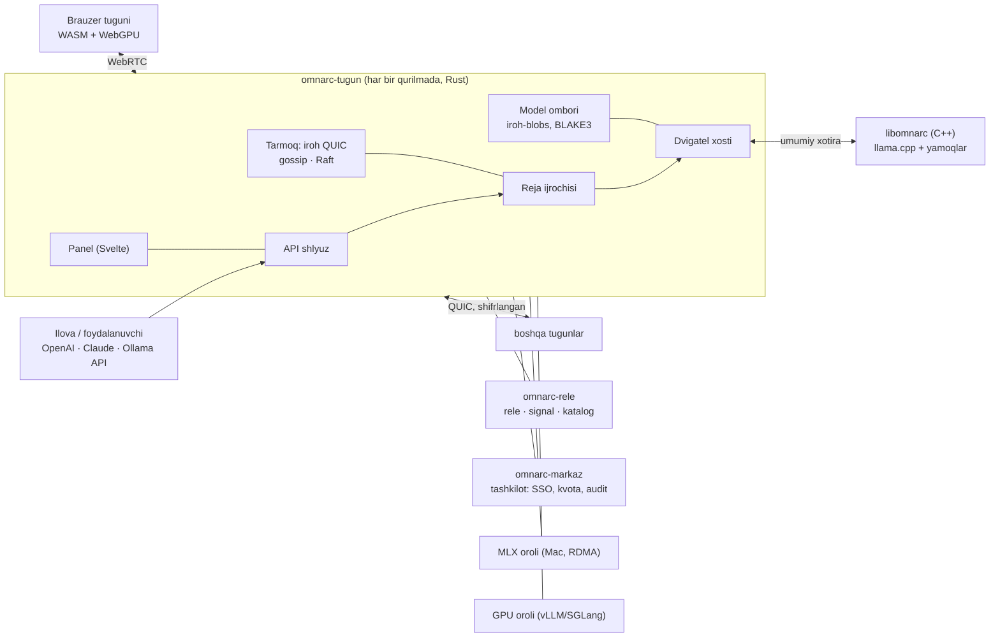

# Omnarc — to'liq reja (v3.2, 13.10.2026)

> **Oʻzbekcha oʻqish nusxasi (13.10.2026, v3.2).** Loyihaning asosiy hujjatlari endi ingliz tilida:
> [PLAN.md](../../PLAN.md) va [REQUIREMENTS.md](../../REQUIREMENTS.md). Bu nusxa siz oʻqishingiz uchun saqlangan.
> Loyihadagi fayl va token nomlari ham inglizchaga oʻtdi: `dizayn/` → `design/`, `konsepsiya.html` → `concept.html`,
> `tirik-halqa.js` → `living-ring.js`, `ranglar.py` → `colors.py`, `tokenlar.*` → `tokens.*`, `manba/` → `upstream/`;
> tokenlar: `--fon` → `--bg`, `--yuza-N` → `--surface-N`, `--matn-N` → `--text-N`, `--firuza` → `--turquoise`,
> `--oltin` → `--gold`, `--oltin-belgi` → `--gold-mark`, `--lojuvard` → `--lapis`, `--yuklama-N` → `--load-N`.
> Interfeysning asosiy tili — ingliz tili; tarjimalar: xitoy, ispan, hind, arab, fransuz, portugal va rus tillari.

> **Nima qilinadi** — [TALABLAR.md](TALABLAR.md). **Qanday qilinadi** — shu fayl: arxitektura, texnologiyalar,
> protokollar, dizayn tizimi, ekranlar va bosqichlar. **Har bir ekran va funksiya holati bilan** —
> [SPETSIFIKATSIYA.md](SPETSIFIKATSIYA.md).
> Dizayn konsepsiyasi (ekranlar ko'rinishi): [dizayn/konsepsiya.html](../../design/concept.html).
> Dizayn tokenlari: [dizayn/tokenlar.json](../../design/tokens.json) (W3C DTCG), [dizayn/tokenlar.css](../../design/tokens.css),
> manbasi va kontrast o'lchovi — [dizayn/ranglar.py](../../design/colors.py).

## 0. Qisqacha

Omnarc istalgan qurilmani — kompyuter, telefon, server, brauzer — bitta AI klasterga birlashtiradi.
Qurilma qo'shilgan sari to'rtta narsa o'sadi: sig'adigan model hajmi, bir vaqtda xizmat qilinadigan
foydalanuvchilar soni, bitta javobning tezligi va aniqligi. Tizim uydan dunyo miqyosigacha ishlaydi; u javob beradi
va modelni o'qitadi ham. Avvalo uchta qo'llanish uchun quriladi ([TALABLAR §1](TALABLAR.md)): o'z modelingizda
agentlar, oila halqasi va aniqlik rejimi.

## 1. Arxitektura



| Komponent | Til | Vazifa | Kimning kodidan |
|---|---|---|---|
| `omnarc-tugun` | Rust | har qurilmadagi agent: tarmoq, reja ijrosi, API, panel, model ombori | exo `rust/networking`, `master/placement.py` g'oyalari |
| `libomnarc` | C++20 | qatlam bo'lagini hisoblash, piped-ring, taxminiy dekodlash, KV | llama.cpp, prima.cpp, PowerInfer |
| `omnarc-veb` | TypeScript, Svelte 5 | panel, brauzer tuguni (PWA), dizayn tizimi | exo `dashboard` |
| `omnarc-ish-stoli` | Rust + Tauri 2 | Linux/Windows/macOS ilovasi, tray | — |
| `omnarc-android` | Kotlin, Compose | telefon ilovasi, fon xizmati, vidjet | prima Android tajribasi |
| `omnarc-ios` | Swift, SwiftUI | iPhone/iPad ilovasi, Live Activity | — |
| `omnarc-markaz` | Python, FastAPI | tashkilot boshqaruvi: foydalanuvchi, SSO, kvota, hisob | GPUStack server |
| `orollar/mlx` | Python | Mac guruhi, RDMA Thunderbolt 5 | exo `worker/engines/mlx` |
| `orollar/gpu` | Python | NVIDIA/AMD server: vLLM, SGLang | GPUStack `worker/backends` |
| `omnarc-rele` | Rust | rele, WebRTC signal, ommaviy tarmoq katalogi | iroh-relay |
| `omnarc-olchov` | Rust + Python | W1–W13 o'lchovi, raqiblar bilan solishtirish | — |

Olingan kod `MANBA.md` bilan saqlanadi: upstream manzili, commit va bizning o'zgartirishlar ro'yxati.

## 2. Texnologiyalar — har qatlamda eng kuchli tanlov

| Qatlam | Tanlov | Nega | Rad etilgan |
|---|---|---|---|
| Dvigatel | **llama.cpp / ggml** (submodul, o'zgartirilmaydi) + kichik yamoqlar to'plami, C++20 | bitta dvigatel 10 backend'da: CUDA, HIP, Vulkan, Metal, OpenCL, Hexagon NPU, SYCL, CANN, WebGPU, CPU | prima'ning eski forki (yangilanmay qolgan, eski modellar); MLC/TVM (har model alohida kompilyatsiya); PyTorch (telefonda yo'q) |
| Tugun agenti | **Rust** (tokio, axum) | bitta koddan 5 platforma, xotira xavfsizligi, telefonga sig'adigan kichik ikkilik fayl | Python (exo — telefonda yo'q); Go (mobil FFI og'ir) |
| P2P tarmoq | **iroh 1.x**: QUIC, qurilmaga IP orqali emas kalit orqali ulanish, NAT teshish (~90 % to'g'ridan-to'g'ri), o'z rele serverimiz; iroh-gossip, iroh-blobs | iyun 2026 da 1.0 bo'lib barqarorlashdi, Rust/Swift/Kotlin bog'lamalari rasmiy | libp2p (murakkabroq); ZeroMQ (prima — NAT teshish va shifrlash yo'q) |
| Brauzer transporti | **WebRTC DataChannel** (Rust: str0m) | iroh brauzerda faqat rele orqali ishlaydi; WebRTC LAN'da to'g'ridan-to'g'ri ulanadi | WebSocket (TCP, kechikish katta) |
| Kelishuv | **openraft** — 3–5 barqaror tugun (kompyuter/server) | reja versiyalari va kalitlar bo'yicha qat'iy kelishuv; telefonlar ovoz bermaydi | yagona boshliq (exo — u uzilsa klaster to'xtaydi) |
| Protokol | **Protobuf + buf**; boshqaruv API — **Connect RPC** | bitta `.proto` fayldan TS, Kotlin, Swift va Python mijozlari yasaladi | REST + qo'lda yozilgan mijozlar |
| Tenzor oqimi | o'z ikkilik freym formatimiz, nol nusxa | har token uchun ortiqcha ish yo'q | gRPC (tenzor uchun og'ir) |
| Rejalashtirish | **HiGHS** MILP (prima'ning Halda formulasi kengaytiriladi) + Parallax'ning 2 bosqichli marshrutlashi + **EPLB** (MoE) | eng kuchli ochiq optimallashtiruvchi (MIT) | qo'lda yozilgan evristika |
| Model tarqatish | **iroh-blobs**: BLAKE3 bilan tekshiriladigan oqim, bayt oralig'i bo'yicha | har qurilma faqat o'z tenzorlarini oladi, uzilsa davom etadi, buzilgan bo'lak qabul qilinmaydi | HTTP yuklash (har qurilma internetdan alohida) |
| Saqlash | **redb** (tugun), **PostgreSQL 17** (markaz), **Prometheus** | redb — sof Rust, ACID, telefonda ishlaydi | SQLite (C bog'liqlik, mobil yig'ish murakkab) |
| Huquqlar | **Ed25519** kimlik + **Biscuit** tokenlar + OIDC/LDAP (tashkilot) | huquqni markazsiz toraytirib uzatish mumkin (model, kvota, muddat) | oddiy API kalit |
| Ommaviy tekshiruv | **TOPLOC** (MIT) + tasodifiy qayta hisob; kreditlar **shaffoflik jurnalida** (C2SP tlog-tiles) | qayta hisobdan ~100 marta arzon tekshiruv; jurnalni har kim tekshira oladi | blokcheyn (sekin, qimmat) |
| Panel va veb | **SvelteKit 2 + Svelte 5**, TypeScript strict, **Tailwind CSS 4**, **Bits UI**, **Paraglide JS**, **Connect-ES** | exo paneli aynan Svelte 5 + Tailwind 4 + d3 — komponentlari olinadi; eng kichik paket (brauzer tuguni sahifasi ≤ 60 KB) | React + Ant Design (GPUStack UI — og'ir paket, oddiy SaaS ko'rinish) |
| Grafika | Halqa — **SVG + Canvas**; globus — **MapLibre GL 5** + **deck.gl 9** + **Protomaps PMTiles** (oflayn xarita); grafiklar — **uPlot** + d3-scale | 1000 qurilmada 60 fps; xarita tashqi xizmatsiz ishlaydi | Google/Mapbox xaritalari (tashqi bog'liqlik) |
| Harakat | CSS + Svelte o'tishlari + **GSAP 3** + **View Transitions API** | GSAP 2025 dan butunlay bepul; sahifa o'tishlari brauzerning o'zida | og'ir animatsiya kutubxonalari |
| Ish stoli | **Tauri 2** (Rust xost + tizim WebView) | ilova ~10 MB, xotira modelga qoladi; agent jarayon ichida | Electron (150+ MB, xotira yeydi) |
| Android | **Kotlin + Jetpack Compose** (Material 3 Expressive), Rust yadro **UniFFI** orqali, Glance vidjet | fon xizmati, NPU, vidjet, Quick Settings — hammasi native | Flutter, React Native (bu qismlar baribir native yoziladi) |
| iOS | **Swift 6 + SwiftUI** (Liquid Glass), UniFFI XCFramework, ActivityKit, WidgetKit, App Intents | Live Activity, Dynamic Island, Siri — faqat native'da | kross-platforma qobiqlar |
| Brauzer tuguni | **llama.cpp → WASM** (Emscripten) + **ggml-webgpu**, PWA | hamma joyda bitta GGUF format; WebGPU backend 2026 da 45–69 % tezlashdi | web-llm (MLC — ikkinchi format) |
| Hujjatlar | **Astro Starlight** + Pagefind | ko'p tilli, oflayn qidiruv | — |
| Sifat | nextest, proptest, **turmoil** (deterministik tarmoq simulyatsiyasi), **TLA+**, cargo-fuzz/libFuzzer, ASan/UBSan, Vitest, **Playwright** (vizual regressiya), axe-core, Lighthouse CI, **Maestro** (mobil), Storybook | taqsimlangan tizim xatolari faqat shu usullar bilan ushlanadi | qo'lda sinash |
| Qurish va CI | Cargo + CMake presets + pnpm + Gradle + Xcode, `just`; GitHub Actions matritsasi; sccache | Linux x64/arm64, Windows, macOS, Android (API 26/30/34/36), iOS, 3 brauzer | — |
| Reliz | cosign imzosi, SBOM (CycloneDX), SLSA kelib chiqish dalili, Tauri imzoli yangilanish | ochiq loyiha ta'minot zanjiri himoyasi | imzosiz ikkilik fayllar |
| Kuzatuv | **OpenTelemetry** (tracing) + Prometheus | token yo'li vaqt chizig'i shu izlardan quriladi | — |

Telemetriya: sukut bo'yicha tashqariga **hech narsa** yuborilmaydi.

## 3. Protokollar

1. **Kimlik.** Har qurilmada Ed25519 kalit bor (iroh NodeId). Klasterning o'z kaliti bor; a'zolik Biscuit token
   bilan beriladi. Huquqlar: `tugun` (qatlam saqlash), `foydalanuvchi` (API), `admin`.
2. **Juftlash.** QR kod ichida klaster chiptasi (iroh ticket) va 10 daqiqalik bir martalik sir bo'ladi. Ikkala
   ekranda 4 ta emoji chiqadi (SAS); mos kelsa, tasdiqlanadi. Begona qurilma klasterga yashirincha kira olmaydi.
3. **Transport.** native↔native — QUIC (iroh). brauzer↔native — WebRTC DataChannel, signal rele orqali.
   Oqim ustuvorligi: tenzor > boshqaruv > telemetriya > model fayllari.
4. **Tenzor freymi.** 32 baytlik sarlavha (so'rov id, qadam, pozitsiya oralig'i, dtype f16/bf16/f8e4m3/i8,
   masshtab, uzunlik) + yuk. QUIC bir tomonlama oqim orqali boradi, ggml buferiga nusxasiz tushadi.
5. **Boshqaruv xabarlari.** Protobuf, `omnarc.v1` versiyasi. Yangi maydon doim ixtiyoriy — eski tugun yangisi
   bilan ishlay oladi.
6. **Holat.** iroh-gossip (HyParView/PlumTree) orqali sekundiga 1 marta telemetriya. Raft — reja versiyasi,
   model joylashuvi, kalitlar.
7. **Topish.** LAN'da mDNS; internetda iroh DNS/pkarr; ommaviy tarmoqda mainline DHT + katalog.
8. **Model.** Bitta tugun Hugging Face'dan yuklaydi → BLAKE3 xesh → iroh-blobs. GGUF tenzor ofsetlari bayt
   oraliqlariga aylantiriladi. Har tugun faqat o'z qatlamlarini oladi va uzilsa to'xtagan joyidan davom etadi.

## 4. Dvigatel — libomnarc

- **llama.cpp submodul + `yamoqlar/`** (qatlam oynasi [a, b), yashirin holat kirish/chiqish, tashqi KV
  boshqaruvi). CI har hafta yamoqlarni upstream'ning yangi versiyasiga avtomatik qayta qo'yib, sinovdan
  o'tkazadi. Yamoqlar upstream'ga PR qilib yuboriladi — maqsad yamoqsiz ishlash. Shunday qilinsa, prima.cpp kabi
  eski versiyada qotib qolinmaydi.
- **prima.cpp'dan olinadi:** piped-ring va disk oldindan o'qish (`src/llama.cpp`), qurilma profileri
  (`common/profiler.cpp`), Halda/HiGHS (`common/common.cpp`), taxminiy dekodlash (`common/speculative.cpp`).
- **Uzluksiz pipeline + taxminiy dekodlash** (PipeSpec, FlowSpec, DiP-SD algoritmlari). Taxmin manbalari:
  MTP boshlari (DeepSeek V3, Qwen3-Next), EAGLE-3, kichik model, n-gram.
- **PowerInfer:** issiq/sovuq neyron predictori va siyrak FFN yadrolari.
- **KV:** sahifali kesh, radix prefiks kesh, q8/q4 KV, qo'shni qurilmaga uzluksiz nusxa (Y7), ring attention (Y9).
- **Faollashuvni siqish:** f8e4m3 (har token uchun masshtab). Xato chegarasi aniqlik darvozasida o'lchanadi.
- **Alohida jarayon.** Kompyuter va serverda dvigatel alohida jarayonda ishlaydi va agent bilan umumiy xotira
  orqali gaplashadi. Dvigatel yiqilsa, agent ishlashda davom etadi va qatlamlar zaxiraga o'tadi. Telefonda
  dvigatel bitta jarayon ichida ishlaydi, chunki iOS bola jarayonga ruxsat bermaydi.
- **Aniqlik darvozasi.** Har backend va kvant uchun natija bitta qurilmadagi hisob bilan solishtiriladi:
  logitlar KL ≤ 0,01, perplexity farqi ≤ 0,5 %. NPU amallari ham shu darvozadan o'tadi (Y3).

## 5. Rejalashtiruvchi

- **Profiler** (qurilma qo'shilganda ~20 s): har backend × kvant uchun FLOPS, xotira tezligi, disk o'qish,
  NPU amallari o'lchanadi.
- **Joylashtirish.** HiGHS MILP koordinatorda ishlaydi: ≤ 64 tugun uchun ≤ 1 s. Katta tarmoq 64 tugunli
  guruhlarga bo'linadi va ierarxik rejalanadi.
- **Hech qachon sekinlashtirmaydi (R6).** Bitta qurilmaga sig'adigan model sekinroq havola orqali bo'linmaydi: ochiq
  sinovda bunday modelni Wi-Fi orqali bo'lish uni 3–5 marta sekinlashtirdi (Mesh LLM: 1 → 2 → 3 Mac'da
  68 → 21 → 12–13 token/s). Qo'shimcha qurilmalar butun nusxa oladi — bir vaqtda ko'proq odam, aniqlik rejimi,
  prefill GPU yoki NPU'li qurilmada. Qatlamlar faqat model sig'magandagina bo'linadi.
- **Marshrut.** Har bir so'rov uchun Parallax DP replikalar grafidan eng tez yo'lni tanlaydi.
- **Hodisalar.** Qurilma qo'shilsa, chiqsa, qizisa yoki batareyasi tushsa — oldindan hisoblangan zaxira reja
  ≤ 1 s ichida ishga tushadi; to'liq qayta yechim fonda hisoblanadi.
- **Maqsad funksiyasi** rejimga qarab tanlanadi: tezlik (TPOT), o'tkazuvchanlik (token/s), tejamkorlik (J/token), aniqlik (Y10).
- **MoE.** Ekspertlar birga faollashish statistikasiga ko'ra joylanadi; issiq ekspertlar EPLB bilan nusxalanadi.

## 6. Qurilma ilovalari

1. **Ish stoli (Linux, Windows, macOS)** — Tauri 2.
   - Tray belgisi kichik halqa ko'rinishida, to'lishi qurilma yuklamasini ko'rsatadi.
   - Foydalanuvchi resurs ulushini (RAM %, GPU %, CPU yadrolari) va ish jadvalini belgilaydi; «faqat kompyuter
     bo'sh turganda» rejimi bor.
   - Avto-yangilanish imzolangan.
   - O'rnatgichlar: MSI, DMG (notarizatsiya bilan), AppImage/deb/rpm, Flatpak, Homebrew, winget, Nix.
2. **Server** — `omnarc-tugun` CLI + systemd, Docker tasviri, Helm chart (GPUStack'dan olinadi).
3. **Android.** minSdk 26 (Android 8); GPU imkoniyatlari ish vaqtida tekshiriladi. CI'da API 26/30/34/36
   emulyatorlarida sinaladi.
   - **Fon xizmati:** API ≥ 34 da `specialUse` — vaqt chegarasi yo'q. `dataSync` Android 15'dan boshlab
     sutkasiga 6 soat bilan cheklangan, shuning uchun tun bo'yi ishlashga yaramaydi. API < 34 da `dataSync`.
   - Quick Settings plitkasi, Glance vidjet, bildirishnoma ichida jonli holat.
4. **iOS** (iOS 17+). iOS fonda uzoq hisoblashga ruxsat bermaydi. Shuning uchun **«Tun rejimi»** bor: telefon
   zaryadda turadi, ilova ochiq bo'ladi, ekran deyarli qora (OLED) bo'lib, soat va halqani ko'rsatadi.
   - Live Activity qulf ekranida va Dynamic Island'da holatni ko'rsatadi.
   - Vidjet va Siri/Shortcuts («kuchimni ulash») bor.
5. **Brauzer.** PWA.
   - WebGPU faqat xavfsiz sahifada (HTTPS) ishlaydi. Shuning uchun sahifa loyihaning HTTPS manzilidan yuklanadi,
     keshda qoladi va LAN'dagi tugunlarga WebRTC orqali ulanadi.
   - Internet umuman bo'lmagan tarmoqda brauzer tuguni faqat oldin keshlangan bo'lsa ishlaydi; aks holda native
     ilova o'rnatiladi.
   - Qo'llab-quvvatlanadi: Chrome/Edge 113+, Android Chrome 121+, Safari 26+, Firefox 141+ (Windows).

## 7. Xavfsizlik va maxfiylik

- Butun trafik shifrlangan: QUIC TLS 1.3, brauzerda DTLS.
- API kalitlari — Biscuit tokenlar: ularni model, kvota va muddat bo'yicha cheklab bo'ladi.
- Ommaviy tarmoq ([TALABLAR §4](TALABLAR.md)):
  - xom matn egasining qurilmasidan chiqmaydi;
  - TOPLOC isboti va 1–2 % tasodifiy qayta hisob;
  - Ed25519 bilan imzolangan kredit kvitansiyalari shaffoflik jurnaliga yoziladi.
- Model butunligi BLAKE3 bilan tekshiriladi. Qurish qayta tiklanadigan; reliz cosign imzosi va SBOM bilan chiqadi.

## 8. Sifat darvozalari (har PR va har bosqich oxirida)

1. Barcha sinovlar yashil. Jim «o'tkazib yuborildi» natijasi yiqilgan sinov deb hisoblanadi.
2. Aniqlik darvozasi (logit KL, perplexity).
3. Deterministik simulyatsiya (turmoil): 1000 ta tasodifiy uzilish/qo'shilish ssenariysi — birorta javob yo'qolmaydi.
4. TLA+ modeli: qayta rejalash va KV nusxa protokoli TLC'da xavfsizlik va jonlilik xossalaridan o'tadi.
5. Fuzz: freym tahlilchisi, protobuf va GGUF o'quvchi 24 soat davomida yiqilmaydi.
6. UI: vizual regressiya (2 mavzu × 390/768/1440 px), axe — 0 xato, butun ilova klaviatura bilan boshqariladi,
   paket byudjetlari saqlanadi, shrift o'lchamlari faqat shkaladan (lint tekshiradi).
7. O'lchov: har bosqich o'z W mezonlarini o'lchab, hisobotga yozadi.

## 9. UI/UX

### 9.1 Tamoyillar

1. **Mexanizmni ko'rsat.** Ekranda haqiqiy jarayon ko'rinadi: qaysi qurilma qaysi qatlamlarni hisoblayapti,
   token hozir qayerda, qayerda sekinlashyapti.
2. **Bir qarashda holat.** Klasterning sog'lig'i 1 soniyada tushuniladi.
3. **30 soniyada qo'shilish.**
4. **Nazorat egasida.** Qurilma nimani va qachon berishini egasi belgilaydi; chegaralar doim ko'rinib turadi.
5. **Jim ishlaydi.** Fondagi hissa foydalanuvchini bezovta qilmaydi.
6. **Hamma uchun.** Asosiy til inglizcha; xitoy, ispan, hind, arab (o'ngdan chapga), fransuz, portugal va rus
   tillariga tarjima; WCAG 2.2 AA; kam harakat rejimi; rang ko'rligiga chidamli.
7. **Tez.** 60 fps va qat'iy byudjetlar (9.8).

### 9.2 Vizual til — «Halqa»

prima'ning piped-ring usuli aynan halqa: qurilmalar halqa bo'ylab turadi va token aylanib o'tadi. Shuning uchun
logotip ham, bosh ekran ham halqa. Har xil uzunlikdagi yoylar (har xil qurilmalar) birgalikda bitta doirani
hosil qiladi — bu Omnarc g'oyasining o'zi.

- **Logotip:** 5 ta notekis yoy va bitta nuqta (token).
- **Ranglar** (OKLCH, mineral bo'yoqlar — iliq oq suvoq ustida lojuvard, firuza va oltin):

  | Token | Tun (standart) | Kun | Vazifa |
  |---|---|---|---|
  | `--fon` | `#060a13` | `#fbf9f6` (suvoq) | sahifa foni |
  | `--yuza-1/2/3` | `#0d131d` / `#151c28` / `#1e2533` | `#ffffff` / `#f4f2ee` / `#ece9e4` | kartalar, panellar |
  | `--matn-1/2/3` | `#f1f3f8` / `#bcc3cf` / `#949ca9` | `#0f1726` / `#3f4858` / `#5d6574` | matn (eng xira — 5,25:1) |
  | `--firuza` | `#3dd7cf` | `#007573` | yagona faol urg'u: asosiy tugma, fokus, token |
  | `--oltin` | `#f2c156` | `#966000` | kredit (matn) |
  | `--oltin-belgi` | `#f2c156` | `#c17b00` | token, logotip nuqtasi (grafik, ≥ 3:1) |
  | `--lojuvard` | `#6189f0` | `#2243ae` | tanlangan holat, havolalar |

  Barcha matn juftlari ikkala mavzuda AA darajasidan o'tadi (≥ 4,5:1, o'lchov: `dizayn/ranglar.py`).
  Urg'u rangi bitta (firuza): qolgan interfeys neytral, rang faqat ma'noli joyda ishlatiladi.
- **Grafik ranglari:** hisob (aqua), tarmoq (ko'k), taxmin (to'q sariq) — 3 ta rang. Ular ikkala mavzuda barcha
  juftlarda rang ko'rligi tekshiruvidan o'tgan (CVD ΔE ≥ 9,2). Yuklama uchun firuza rangining 7 pog'onali
  shkalasi ishlatiladi. Holat uchun 4 ta rang bor va ular doim belgi hamda yozuv bilan birga chiqadi.
- **Shriftlar:** **Inter** (o'zgaruvchan, opsz) + **IBM Plex Mono** (raqamlar, ID) — lotin, kirill va yunon
  yozuvlari uchun; **Noto Sans SC**, **Noto Sans Arabic** va **Noto Sans Devanagari** — xitoy, arab va hind tillari
  uchun. Har yozuvning shrifti faqat o'sha til yoqilganda yuklanadi (`unicode-range`). Shriftlar o'z serverimizdan
  beriladi (woff2), tashqi so'rov yo'q.
- **Shrift shkalasi** (9 pog'ona): 11 · 12 · 13 · 14 · 16 · 20 · 28 · 40 · 56. Boshqa o'lcham ishlatish taqiqlangan.
- **Joylashuv:** oraliq 4px panjarasida (4…64), burchaklar 6/10/16, chiziqlar 1px.
- **Harakat:** davomiylik 120/200/320/480 ms, egri chiziq `cubic-bezier(.2,.8,.2,1)`.
  - Faqat `transform` va `opacity` animatsiya qilinadi.
  - Kirish animatsiyalarida `fill-mode: backwards`.
  - Kam harakat rejimida zarrachalar o'chadi, oqim strelkalar bilan ko'rsatiladi.

### 9.3 Tirik belgi

Belgi chizilgan rasm emas — u tizim mexanizmining jonli modeli.
Kodi: [dizayn/tirik-halqa.js](../../design/living-ring.js) — WebGL2, kutubxonasiz, ~16 KB.
Ishlatiladigan joylar: ochiq sahifa, ilovaning ochilish ekrani, birinchi ishga tushirish, qurilma qo'shilgan lahza.

- **Yoylar va zarrachalar.** Har yoy — bitta qurilma, uzunligi — qatlamlar ulushi. Yoy ~15 000 zarrachadan iborat:
  ichki yorug' tola, asosiy o'zak, chang va yumshoq nur qatlami. Ularning harakatini GPU hisoblaydi, protsessor ishtirok
  etmaydi.
- **Tokenlar.** Oltin kometalar; bir vaqtda qurilmalar sonicha token yuradi (uzluksiz pipeline).
  - Token o'tgan joy yorishib, oltinga moyil bo'ladi.
  - Kometa oldidagi xira uchqunlar — taxminiy tokenlar; rad etilganlari so'nadi.
  - Tepadagi oraliq — chiqish: har token chiqqanda to'lqin tarqaladi.
- **Kirish sahnasi «Birlashish» (2,6 s).** Atrofdagi tarqoq nuqtalar spiral bo'lib yig'iladi va yoylar birin-ketin
  shakllanadi. Qurilma nomlari halqa to'liq bo'lgandan keyin chiqadi.
- **Ta'sir.**
  - Sichqoncha yoki barmoq halqani 3D og'diradi.
  - Yoy ustiga kelinsa, u yorishadi va qurilma nomi chiqadi.
  - «Qurilma qo'shish» bosilsa, yangi yoy o'sib chiqadi, 64 qatlam qayta taqsimlanadi (eng katta qoldiq usuli) va
    tokenlar soni bittaga oshadi.
- **Kam harakat rejimi:** shakllangan halqa statik chiziladi.
- **WebGL2 bo'lmasa:** SVG belgi chiqadi.
- **Tejamkorlik:** belgi ekrandan chiqsa, chizish to'xtaydi.

### 9.4 Halqa ko'rinishi (bosh ekran)

- **Yoylar.** Har bir qurilma — bitta yoy. Yoy uzunligi qurilmadagi qatlamlar ulushiga teng. Yoylar orasida 2px
  bo'shliq qoldiriladi (chegara chizig'i chizilmaydi). Yoy rangi joriy yuklamani ko'rsatadi (firuza shkalasi).
- **Token oqimi.** Token — halqa bo'ylab harakatlanuvchi nuqta. Uning har bir yoydagi tezligi o'lchangan
  haqiqiy vaqtga teng, shuning uchun sekin qurilma darhol ko'zga tashlanadi. Taxminiy tokenlar bir vaqtda bir
  nechta xira nuqta bo'lib yuradi: qabul qilingani yorishadi, rad etilgani so'nadi. Y1 shu tarzda ko'rinadi.
- **Markaz.** Bitta asosiy raqam — token/s. Uning ostida model nomi va rejim yoziladi.
- **Tashqi ingichka belgilar:** zaryad, harorat va batareya — doim belgi bilan.
- **Ko'p model** bir vaqtda ishlasa, ichma-ich halqalar chiziladi. 128 tadan ortiq qurilmada yoylar guruhlarga
  birlashadi, bosilganda kattalashadi.
- **Ochiqlik.** «Jadval» tugmasi bir xil ma'lumotni jadval ko'rinishida beradi. Klaviatura fokusi yoydan yoyga
  o'tadi. Ekran o'quvchiga qisqa xulosa o'qiladi («6 qurilma; eng sekini — telefon, 38 ms»).

### 9.5 Panel tuzilishi

| Bo'lim | Ko'rsatadi | Asosiy amal |
|---|---|---|
| Halqa | jonli klaster, asosiy raqam, qurilmalar ro'yxati | model tanlash, rejim |
| Qurilmalar | har qurilma: backend, xotira, harorat, ulush, havolalar | ulush va jadval, chiqarish |
| Modellar | katalog, «Sig'adimi?», P2P yuklash | ishga tushirish |
| Suhbat | sinov maydoni, token qaysi qurilmada hisoblangani, aniqlik rejimida — nechta qurilma rozi bo'lgani | savol berish |
| Kuzatuv | token yo'li vaqt chizig'i, havolalar matritsasi, izlar | sekin joyni topish |
| O'qitish | LoRA va RL ishlari, raundlar, loss | ish boshlash |
| Tarmoq | ommaviy tarmoq globusi, kredit | qo'shilish, chiqish |
| Tashkilot | foydalanuvchilar, kalitlar, kvota, jadval, audit | siyosat |
| Sozlamalar | til, mavzu, xavfsizlik, yangilanish | — |

Har qanday amalni **⌘K buyruqlar paneli** orqali ham bajarish mumkin; barcha amallar uchun klaviatura
yorliqlari bor. Panel jonli ma'lumotni Connect oqimi orqali oladi.

### 9.6 Asosiy oqimlar

1. **Birinchi ishga tushirish (≤ 60 s).**
   - Qurilma aniqlanadi va 20 soniyalik o'lchovdan o'tadi.
   - Foydalanuvchi klaster yaratadi yoki mavjudiga qo'shiladi (LAN'dagilari o'zi chiqadi).
   - Ulush belgilanadi.
   - Halqada yangi yoy o'sib chiqadi.
2. **Qurilma qo'shish (≤ 30 s).** Kompyuterda QR → telefon kamerasi → 4 emoji tasdig'i. Qo'shilgan qurilma
   halqada joy oladi, qolgan yoylar silliq qayta taqsimlanadi.
3. **Modelni ishga tushirish.**
   - «Sig'adimi?»: kerakli xotira klaster xotirasiga solishtiriladi va kutilayotgan tezlik oralig'i ko'rsatiladi.
   - Joylashuv rejasi halqada oldindan ko'rinadi.
   - Model P2P yuklanadi va ishga tushadi.
4. **Telefon hissasi.** Bitta katta tugma «Kuchimni ulash». Qoidalar: faqat zaryadda, faqat Wi-Fi'da,
   batareya ≥ 40 %, harorat ≤ 40 °C, RAM ≤ 50 %, jadval.
5. **Uzilish.**
   - Qurilma chiqsa, uning yoyi so'nadi va zaxira yonadi.
   - Bildirishnoma chiqadi: «Telefon uzildi — zaxira davom ettirdi (0,8 s)».
6. **Kuchsiz telefon — ovozli mijoz (Q6).** Telefon halqaning QR kodini skanerlab mijoz bo'lib qo'shiladi; bitta tugma —
   bosib turib gapiriladi — javob ovoz bilan qaytadi.

### 9.7 Platformaga xos tajriba

- **Ish stoli:** tray'dagi halqa.
- **iOS:** Live Activity, Dynamic Island, vidjet, Siri, Tun rejimi.
- **Android:** Quick Settings plitkasi, Glance vidjet, bildirishnomadagi jonli holat.
- **iOS 26:** Liquid Glass ko'rinishini oladi.
- **Android:** Material 3 Expressive ko'rinishini oladi.
- **Umumiy brend** (rang tokenlari, shriftlar, halqa) uchala platformada ham bir xil. Tokenlar bitta JSON'dan
  CSS, Swift va Kotlin'ga yig'iladi.

### 9.8 Byudjetlar

- Panelning boshlang'ich JS hajmi ≤ 180 KB (gzip).
- Brauzer tuguni sahifasi ≤ 60 KB (model bo'lagi hisobga kirmaydi).
- Halqa 1000 qurilmada 60 fps.
- LCP ≤ 1,5 s (LAN).
- Mobil ilova sovuq start ≤ 1 s.

### 9.9 Til

Asosiy til — ingliz tili. Tarjimalar — xitoy (soddalashtirilgan), ispan, hind, arab, fransuz, portugal va rus —
Paraglide orqali kompilyatsiya vaqtida qo'shiladi. Arab tilida sahifa o'ngdan chapga joylashadi: CSS mantiqiy
xossalardan foydalanadi, yo'nalish ko'rsatadigan belgilar ko'zgudagidek aylantiriladi. Raqam va sanalar har tilning
o'z formatida (`Intl`).

## 10. Repo tuzilishi

```
omnarc/
  dvigatel/        libomnarc (C++), llama.cpp submodul, yamoqlar/
  tugun/           Rust workspace: tugun, tarmoq, reja, ombor, api, protokol, ffi, simulyatsiya
  protokol/        .proto (buf), freym spetsifikatsiyasi, TLA+ modellari
  veb/             SvelteKit: panel/, brauzer-tugun/, komponentlar/ (Storybook)
  ish-stoli/       Tauri 2
  android/         Kotlin + Compose
  ios/             SwiftUI + XCFramework
  markaz/          GPUStack asosida (Python)
  orollar/         mlx/ (exo asosida), gpu/ (GPUStack asosida)
  rele/            rele, signal, katalog
  olchov/          o'lchov skriptlari va natijalar
  dizayn/          tokenlar.json, tokenlar.css, ranglar.py, konsepsiya.html
  hujjat/          Astro Starlight (en, zh-Hans, es, hi, ar, fr, pt, ru)
  NOTICE · LICENSE (Apache-2.0) · MANBA.md
```

## 11. Bosqichlar

UI har bosqich bilan birga quriladi — oxiriga qoldirilmaydi.

| B | Ish | Darvoza (bosqich tugaganini isbotlaydi) |
|---|---|---|
| **B0 Poydevor** | monorepo, CI matritsasi, `protokol/` v1, dizayn tokenlari → CSS/Swift/Kotlin, Svelte komponent kutubxonasi (Storybook), NOTICE/MANBA.md | 6 platformada CI yashil; komponentlar vizual regressiyadan o'tadi; axe — 0 xato |
| **B1 Dvigatel** | libomnarc: yamoqlar, prima piped-ring + oldindan o'qish, CUDA/Vulkan/Metal/CPU, Windows, alohida jarayon | aniqlik darvozasi (Llama 3.x 8B, Qwen3 32B, R1-Distill 70B); Linux + Windows kompyuterlarda 70B ishlaydi; bir xil apparatda TPOT prima.cpp'dan yomon emas |
| **B2 Tarmoq** | iroh, gossip, Raft, QR + SAS, iroh-blobs, havolalarni o'lchash, freym tahlilchisi, protobuf va GGUF o'quvchisi uchun fuzzing (§8); panel: birinchi ishga tushirish, Halqa, Qurilmalar, Sozlamalar, tirik belgi | NAT ortidagi 2 xil tarmoqdagi qurilmalar bitta klasterda; 70B bo'laklari P2P tarqaladi (internetdan 1 marta); turmoil'da 1000 ssenariy |
| **B3 Rejalashtiruvchi** | profiler, HiGHS, marshrut, zaxira reja, KV nusxa, jonli qo'shilish/chiqish, TLA+, sekinlashtirmaslik qoidasi (R6); panel: «Sig'adimi?», reja ko'rinishi, bildirishnomalar | W6 (≤ 1 s); W11; TLC xossalari; 8 qurilmaga joylashtirish ≤ 1 s |
| **B4 Tezlik va aniqlik** | pipeline taxminiy dekodlash, MTP/EAGLE-3, PowerInfer, MoE + EPLB, f8 faollashuv, ring attention, radix kesh, batching, prefill/dekod ajratish, aniqlik rejimi (Y10); panel: token yo'li, havolalar matritsasi, Suhbat | W1, W2, W3, W12 |
| **B5 Qurilmalar** | Tauri, Android (Compose, Hexagon, `specialUse`), iOS (SwiftUI, Metal, Tun rejimi, Live Activity), brauzer PWA (WASM + WebGPU, WebRTC), faqat mijoz telefonlar (Q6), NPU darvozasi, yettita tarjima (arabchasi o'ngdan chapga) va Noto shriftlari | W4, W5, W8; Maestro oqimlari; Android API 26–36 |
| **B6 Miqyos** | markaz (OIDC/LDAP, RBAC, kvota, jadval, audit), ommaviy tarmoq (katalog, TOPLOC, kredit jurnali); panel: Tashkilot, Tarmoq, Kredit | W7; aldovchi tugunlar 100 % aniqlanadi |
| **B7 Modallik va o'qitish** | STT, TTS, rasm (stable-diffusion.cpp), embedding; LoRA (DiLoCo), RL rollout; panel: O'qitish | internet orqali 4+ tugunda kam resursli til uchun LoRA o'qitiladi; audio va rasm API'lari ishlaydi; oila halqasi: kuchsiz telefondan (≤ 4 GB) ovozli savolga ovozli javob, birinchi tovush savol tugagach ≤ 3 s, internet o'chiq bo'lsa ham |
| **B8 Orollar va API** | MLX oroli (RDMA TB5), GPU oroli (vLLM/SGLang), to'liq API moslik, agentlar uchun backend (A4); panel: Modellar katalogi | W9; W13; rasmiy SDK'lar (openai, anthropic, ollama) bilan moslik sinovlari |
| **B9 Jahon o'lchovi va reliz** | omnarc-olchov (exo, prima, Parallax, distributed-llama, llama.cpp RPC, Mesh LLM, colibri bilan bir xil apparatda), natijalar sayti, hujjatlar 8 tilda, imzoli relizlar, do'konlar | W10; v1.0 |

## 12. Tarqatish

- **Ikkilik fayllar:** GitHub Releases (imzolangan).
- **Ish stoli:** Homebrew, winget, Flathub.
- **Mobil:** Google Play, F-Droid, App Store / TestFlight.
- **Server:** Docker (GHCR), Helm.

## 13. Siz ta'minlaydigan shartlar

| Shart | Nima uchun | Bo'lmasa |
|---|---|---|
| Apple Developer hisobi ($99/yil) | iOS ilova, macOS notarizatsiya | iOS faqat o'z qurilmangizga o'rnatiladi |
| Google Play hisobi ($25, bir marta) | Play do'koni | F-Droid va to'g'ridan-to'g'ri APK |
| Domen | brauzer tuguni sahifasi (HTTPS), rele, hujjatlar | GitHub Pages manzili |
| Sinov qurilmalari: 2 kompyuter (biri NVIDIA), 2 Android (biri Snapdragon 8 Gen 2+), 1 iPhone, 1 Mac (Apple Silicon) | W1–W5 o'lchovlari | o'lchov faqat mavjud qurilmalarda |
| GPU'li mashinada CI runner | CUDA sinovlari | CUDA faqat qo'lda sinaladi |

## 14. Kim uchun va o'zini qanday oqlaydi

Butun mahsulot bitta jumlaga tayanadi:

> **Sizda allaqachon bor qurilmalar AI ni yurgiza oladi. Omnarc ularni birlashtiradi.**

Buni boshqa hech kim ayta olmaydi. GPU bulut o'zi sotib olgan apparatni sotadi. Bulutdagi yordamchi
birovning markazida ishlaydi. exo faqat Mac, GPUStack faqat NVIDIA serverlari, Mesh LLM da telefon ham,
brauzer ham yo'q. Klaster — mahsulotning imkoniyati emas, **mahsulotning o'zi**.

### 14.1 Ikki yuz, bitta klaster

Dvigatel va halqa (B1–B4) yadro bo'lib qoladi. Ularning ustida ikki yuz turadi va alohida chiqariladi:

| Yuz | Kim ochadi | Nima u |
|---|---|---|
| **Yordamchi** | odamlar | so'rash, yozish, hujjat o'qish, kun rejasi — xonadagi qurilmalarda |
| **Ish maydoni** | dasturchilar | modelni yurgizish, API, deploy, xarajatni ko'rish |

Ikkalasi ham bitta tugun agenti bilan gaplashadi. Ikkinchi xil hisoblash o'ylab topilmaydi: yondagi
qurilmalar yetmasa, tarmoqdan so'raladi (§14.3), markazdagi GPU ijaraga olinmaydi.

### 14.2 Bosqichlar

Bosqichlar `TALABLAR.md` §2 dagi uch miqyosga ergashadi va har biri uni ko'taradigan bosqich tugaganda
sotiladigan bo'ladi. Darvozasidan oldin sotish — ishontirilgan odamlarni yo'qotishning yo'li.

| Bosqich | Miqyos | Nima qo'shadi | Tayyor |
|---|---|---|---|
| **Bepul** | Shaxsiy | o'z qurilmalaringiz, ma'lumot chiqmaydi, internetsiz ishlaydi | B5 |
| **Uy** | Shaxsiy | bir nechta qurilma birlashadi → bittasiga sig'maydigan model ishlaydi | B5 |
| **Dasturchi** | Shaxsiy | API, deploy, model katalogi, xarajat ko'rinishi | B8 |
| **Tashkilot** | Tashkilot | tungi ofis: bo'sh mashinalar bitta klaster; hisoblar, kvota, audit | B6 |
| **Tarmoq** | Ommaviy | qurilmangizni bering — kredit oling; o'zingizniki yetmasa — sarflang | B6 |

### 14.3 Pul qayerdan keladi

Hisoblash foydalanuvchining o'ziniki, demak hisoblash sotilmaydi. Sotiladigani — uning atrofidagi
hamma narsa: hisoblar va rollar, kvota va jadval, audit izi, boshqa tarmoqdagi qurilmalarni
tanishtiradigan relelar, imzolangan chiqarishlar va qo'llab-quvvatlash. Shakl bulutga emas, park
boshqaruvchisiga yaqin: klaster bepul, klasterlar parkini boshqarish esa yo'q.

Daromad **Tashkilot** dan kutiladi. Kompaniya mashinalarni allaqachon sotib olgan va GPU soatiga
allaqachon to'layapti — ehtiyoj ham, byudjet ham bir stolda turgan yagona bosqich shu. Odamlar kam
to'laydi: Bepul va Uy bosqichlari — loyiha tanilishi yo'li, shuning uchun ular birovga aytgudek
yaxshi bo'lishi shart. Tarmoq bosqichi — bozor, va uni halol qiladigan narsa kredit jurnali (B6).

### 14.4 Hech qachon va'da qilinmaydigan narsalar

Uchta va'dani birinchi o'lchagan odam buzadi, shuning uchun ular berilmaydi:

- **Markazdan tez.** Modelni uy havolalari ustida bo'lish sekinroq, va sekin qoladi. Ikki oddiy
  mashinadagi o'lchangan halqa ijaradagi GPU dan ancha past chiqdi. Omnarc narxda, maxfiylikda,
  internetsiz ishlashda va **o'zingizdagi bironta mashinaga sig'maydigan** modelni yurgizishda
  yutadi — soniyadagi tokenda emas.
- **Birovning modeliga arzon yo'l.** Bulutdagi API ni qayta sotish — yupqa foyda va odatda uning
  shartlariga zid. Katalog bunday modellarni ko'rsatishi mumkin, lekin ularni o'ziniki deb atamaydi.
- **Hamma narsani bo'lish.** `R6` bitta qurilmaga sig'adigan modelni bo'lishni taqiqlaydi: ommaviy
  sinovda bu generatsiyani 3–5 barobar sekinlashtirgan. Ortiqcha qurilmalar butun nusxa oladi.

### 14.5 Tartib

Yuzlar bosqich tartibini o'zgartirmaydi, unga ulanadi. B5 Bepul va Uy ni haqiqiy qiladi, chunki
qurilma ilovalari o'sha yerda tushadi. B6 Tashkilot va Tarmoq ni haqiqiy qiladi, chunki hisoblar,
kvota va kredit jurnali o'sha yerda. B8 Dasturchi ni haqiqiy qiladi, chunki API va orollar o'sha yerda.
Shungacha mahsulot reja sifatida aytiladi, sotiladigan narsa sifatida emas.
